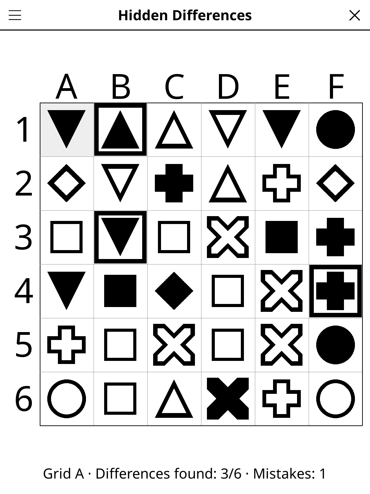

# spotdiff.koplugin

**Hidden Differences** (*Différences cachées*) is a cooperative game for
[KOReader](https://github.com/koreader/koreader), played by two people with a
reader each. Both readers show a grid of symbols; the two grids are the same
except for a few cells. Find them together, without looking at the other
screen.

## How to play

1. One player opens **New game → Start a game** and reads the five-digit
   code aloud; the other opens **New game → Join a game** and types it.
   Each one picks a grid, A or B.
2. Describe your grids to each other: "row 2: black circle, white square,
   black cross…". Letters and numbers around the grid help.
3. Tap a cell you think differs. A difference gets a thick frame; a wrong
   cell turns grey and counts as a mistake.
4. The game is won when every difference is found.

## Features

- **No connection needed** — both readers build the same pair of grids from
  the code, and the code's check digit refuses a typo.
- **Three levels**, set by the player who starts: Easy 5×5 with 4
  differences (filled shapes only), Medium 6×6 with 6, Hard 7×7 with 8
  look-alikes (a white circle for a black one, a triangle turned over…).
- **Show the differences** — gives up and frames the ones left.
- **Auto-save** — the game resumes where you left it; **Show the game
  code** reads it again.
- French, Spanish and German translations.

## Why e-ink friendly?

The grids are static; each tap repaints the grid once.

## License

GPL-3.0
